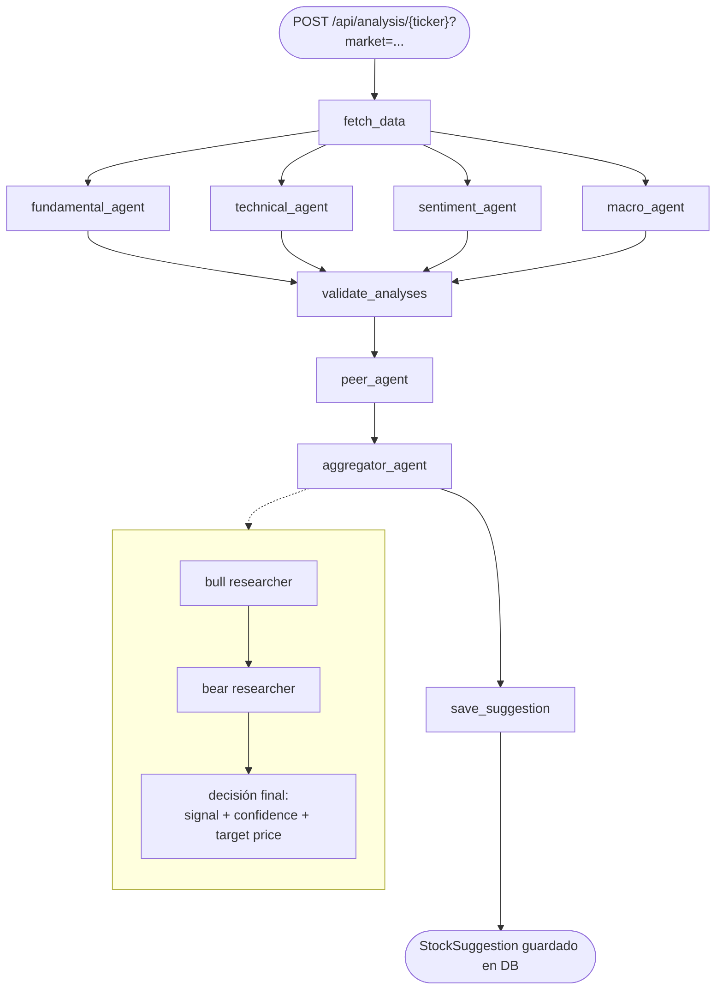
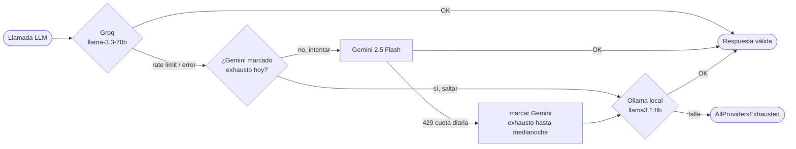

# Flujo de análisis de stocks

Este documento explica cómo StockBot analiza un ticker, desde el request HTTP hasta la sugerencia guardada, y qué cambia según el mercado (`US`, `EU`, `LATAM`, `CRYPTO`).

## 1. Vista general

Los 4 mercados comparten **el mismo grafo** (`app/agents/workflow.py::build_workflow`). Lo que cambia entre mercados es de dónde vienen los datos en `fetch_data`, no la estructura del grafo.

- **`fundamental_agent` / `technical_agent` / `sentiment_agent` / `macro_agent`** corren **en paralelo** — cada uno hace 1 llamada LLM.
- **`validate_analyses`** aborta si los 4 fallaron; si falló solo alguno, sigue en modo degradado (queda registrado en `errors`).
- **`aggregator_agent`** internamente hace 3 llamadas LLM secuenciales: caso bull, caso bear, y la decisión final (`FinalDecision`: signal, confidence, precios objetivo).
- Total por análisis: **hasta 8 llamadas LLM** (4 paralelas + peer + bull + bear + decisión final).

## 2. Cadena de fallback LLM (compartida por las 8 llamadas)

Cada una de esas 8 llamadas pasa por la misma cadena de proveedores, de forma independiente:

- **Validación con reintento**: si la respuesta no cumple el schema Pydantic (ej. campo muy largo, tipo incorrecto), se reintenta **una vez** en el mismo proveedor, esta vez incluyendo el error de validación en el prompt para que el modelo se autocorrija.
- **Rate limiting real**: cada llamada pasa por `RateLimiter.acquire()` (Groq/Gemini) antes de salir a la red.
- **Exhaustion flag**: cuando Gemini responde con cuota diaria agotada (25→ahora 20 real/día), se marca exhausto en Redis hasta medianoche — las siguientes 7 llamadas de ese mismo análisis se saltan Gemini sin gastar red.

## 3. Qué cambia por mercado

```mermaid
flowchart TD
    FD[fetch_data] --> PRICE{price_history}
    FD --> FUND{fundamentals}
    FD --> EARN{earnings /<br/>upcoming_earnings}
    FD --> NEWS[news]
    FD --> SENT[sentiment]
    FD --> PEERS{peers}

    PRICE -->|US| P1[us_stocks.py<br/>yfinance → Finnhub candles]
    PRICE -->|EU| P2[europe.py<br/>yfinance, sufijo .DE etc.]
    PRICE -->|LATAM| P3[latam.py<br/>yfinance .LM / ADR fallback a US]
    PRICE -->|CRYPTO| P4[crypto.py<br/>Binance klines → CoinGecko OHLC]

    FUND -->|US| F1[FMP → yfinance → Finnhub EPS]
    FUND -->|EU| F2[yfinance .info únicamente]
    FUND -->|LATAM ADR<br/>BAP/BVN/SCCO/IFS| F3[mismo path que US<br/>+ Alpha Vantage fallback<br/>solo para debt_to_equity]
    FUND -->|LATAM BVL-local| F4[SMV SOAP<br/>obtener_GanciaPerdida<br/>+ cache 24h por RUC]
    FUND -->|CRYPTO| F5[CoinGecko<br/>pe/pb/debt = None por diseño]

    EARN -->|solo US| E1[Finnhub]
    EARN -->|EU/LATAM/CRYPTO| E2["'sin earnings próximos'<br/>(nunca se pide)"]

    NEWS --> N1[Finnhub → Yahoo RSS<br/>igual en los 4 mercados]
    SENT --> S1[StockTwits + Reddit/ApeWisdom<br/>+ news sentiment — igual en los 4]

    PEERS -->|US| PE1[Finnhub peers API]
    PEERS -->|EU| PE2[grupo sectorial curado<br/>ej. MBG/BMW/VOW3]
    PEERS -->|LATAM| PE3[grupo sectorial curado<br/>ej. BAP/IFS/CREDITC1]
    PEERS -->|CRYPTO| PE4["ninguno<br/>(no aplica)"]
```

## 4. Resumen por mercado

| | **US** | **EU** | **LATAM** | **CRYPTO** |
|---|---|---|---|---|
| **Precio** | yfinance → Finnhub | yfinance (sufijo `.DE` etc. vía `EU_TICKERS_YF`) | yfinance `.LM` / ADR → path US | Binance → CoinGecko |
| **Fundamentales** | FMP → yfinance → Finnhub | Solo yfinance `.info` | ADR: US + Alpha Vantage (debt/equity) · BVL-local: SMV SOAP | CoinGecko (varios campos `None` por diseño) |
| **Earnings** | ✅ Finnhub | ❌ nunca se pide | ❌ nunca se pide | ❌ nunca se pide |
| **Peers** | ✅ Finnhub (dinámico) | ✅ grupo curado (`EU_PEER_GROUPS`) | ✅ grupo curado (`LATAM_PEER_GROUPS`) | ❌ no aplica |
| **News / Sentiment** | ✅ Finnhub/Yahoo RSS + StockTwits + Reddit | ✅ igual que US | ✅ igual que US | ✅ igual que US |

## 5. Limitaciones conocidas (documentadas, no bugs)

- **`debt_to_equity` / `free_cash_flow_yield` en EU y BVL-local**: sin fuente gratuita confirmada (FMP, Twelve Data y EODHD probados en vivo — todos bloquean cobertura internacional en el free tier). El prompt del `fundamental_agent` y del `BEAR_RESEARCHER_SYSTEM` ya avisan al LLM que esto es normal para estos mercados, para que no lo use como señal de riesgo automática.
- **Earnings solo para US**: Finnhub no cubre calendarios de earnings fuera de US en este proyecto; EU/LATAM/CRYPTO simplemente no lo piden.
- **CRYPTO sin peers**: no hay un concepto equivalente de "comparables" para un criptoactivo (sin equity, sin EPS).
- **SMV (BVL-local)**: solo cubre `revenue_growth_yoy`/`earnings_growth_yoy` (el SOAP de SMV solo trae estado de resultados, no balance) y solo para tickers con RUC mapeado en `TICKER_TO_RUC` (hoy: `ALICORC1` verificado; el resto queda pendiente de lookup manual).
